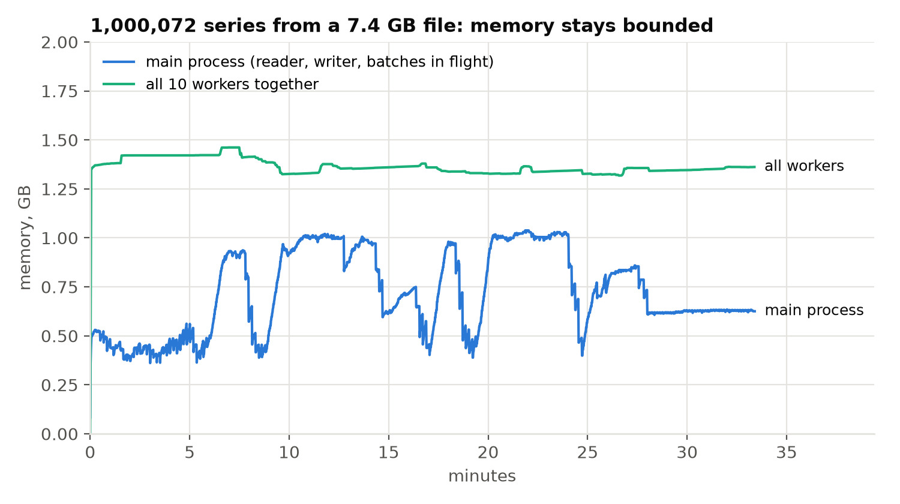

# Streaming a large CSV on macOS, Apple M4 (10 cores)

2026-10-22 · macOS 26.5.2 arm64 · prophet 1.5.0 and **prophet-batch 0.1.2, both from PyPI** · examples `d5f2058` ·
M5 items (1,913 training days each, 28-day forecasts), the CSV prepared by [prepare.py](../prepare.py) · 10 workers,
1,000 series per batch, one `Pool` for the whole run · reproduce:

```sh
uv run python -m streaming_csv.prepare --copies 8                                   # ×1, ×2, ×4, ×8 likewise
uv run python -m streaming_csv.run data/streaming/m5_item-x8.csv --series-per-batch 1000
uv run python -m streaming_csv.prepare --copies 328 --perturb --gzip --jobs 8       # ≈ 1 million series, 7.4 GB
uv run python -m streaming_csv.run data/streaming/m5_item-x328p.csv.gz --series-per-batch 1000
uv run python -m streaming_csv.check data/streaming/m5_item-x328p.csv.gz --first-series 20000
```

| copies | series | input | time | series / s | main process peak | largest worker | all workers |
|---:|---:|---:|---:|---:|---:|---:|---:|
| 1 | 3,049 | 169 MB | 7.5 s | 409 | 0.42 GB | 0.14 GB | 1.36 GB |
| 2 | 6,098 | 356 MB | 13.7 s | 445 | 0.50 GB | 0.14 GB | 1.37 GB |
| 4 | 12,196 | 730 MB | 25.4 s | 480 | 0.53 GB | 0.14 GB | 1.38 GB |
| 8 | 24,392 | 1,478 MB | 50.5 s | 483 | 0.56 GB | 0.14 GB | 1.38 GB |
| 328 (resampled) | 1,000,072 | 7,417 MB (gzip) | 2,004.4 s | 499 | 1.04 GB | 0.14 GB | 1.46 GB |

- **Memory is set by the batch size, not the file.** From ×1 to ×8 the file grows 8.7× and the main process's peak
  0.42 → 0.56 GB; each worker stays at 0.14 GB. Over the 33-minute million-series run the main process moved between
  0.4 and 1.04 GB with no upward trend (reading gzip and the allocator over a long run give wider swings), and the ten
  workers together held ≈ 1.4 GB.
- **Throughput holds:** ≈ 480–500 series per second from ×4 on, 1,000,072 series in 33.4 minutes. Reading, forecasting
  and writing overlap (summed stage times for the million: read 641 s, forecast 1,923 s, write 107 s, in 2,004 s).
- **The output is right.** ×1 and ×8: every part together equals one in-memory `forecast_many` of the whole file
  (largest relative difference 2.2·10⁻¹⁶, from the CSV round trip). The million: all 1,000,072 series are in the 1,001
  parts, once each, in order, and the first 20,000 equal an in-memory `forecast_many` of those rows.
- The million series are 328 copies of the 3,049 M5 items, every copy after the first resampled
  (y′ = Poisson(f·y), f ~ U(0.5, 2) per series and copy), so they are different series of the same kind, not repeats.


